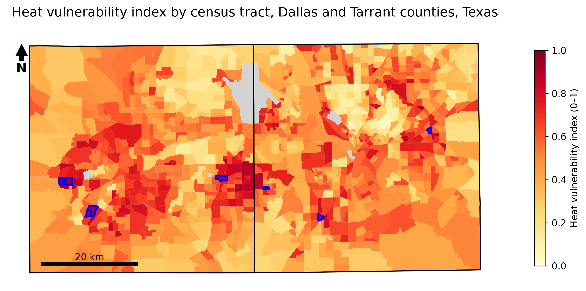

# DFW Urban Heat: Surface Heat Exposure for Car-Free Households

**Are Dallas–Fort Worth census tracts with high rates of car-free households exposed to higher summer surface temperatures, and how does heat vary around DART and Trinity Metro rail stations?**

This project uses NASA/USGS Landsat 8 and 9 satellite data in Google Earth Engine to map summer land surface temperature and vegetation across 1,094 census tracts in Dallas and Tarrant counties, Texas. It joins those results with Census vehicle-access and income data and builds a **heat vulnerability index (HVI)** to show where cooling efforts, such as tree planting and shaded transit stops, would help the most people.

It extends the [DFW Food & Transportation Access Map](https://github.com/tinlongg/DFW_Railway_Dashboard), which studied food access for the same tracts.



**Links:** [Report (PDF)](report/) · [Live dashboard](#) · [Notebook](heat.ipynb)

---

## Key Findings

- **Car-free households live in hotter tracts.** Tracts in the top quarter for car-free households (≥ 8.6%) averaged **118.4 °F**, compared with **117.1 °F** for other tracts, a modest but significant difference of **1.3 °F** (Welch's t-test, p < 0.001).
- **They are overrepresented in the hottest areas.** The hottest 20% of tracts hold **20.6%** of all households but **25.1%** of car-free households.
- **Vegetation is the strongest factor in surface heat.** Tract NDVI and surface temperature are strongly negatively correlated (**Pearson r = −0.80**). Each 0.1 increase in NDVI corresponds to about **3.4 °F** cooler surfaces.
- **Vulnerability clusters in southeast Fort Worth.** Six of the ten highest-HVI tracts are nearest **T&P Station**.
- **Food access and heat affect different neighborhoods.** Food-desert tracts were about 1.8 °F *cooler* on average, and greener.

> Land surface temperature measures how hot the ground and rooftops get at Landsat's late-morning overpass. It runs much hotter than the air temperature people feel.

---

## Methods Overview

```
Landsat 8 + 9 (summers 2020–2024, < 20% cloud cover)
        │
        ▼
Mask clouds, cloud shadows, and water (QA_PIXEL)
        │
        ▼
Land surface temperature (°F) + NDVI → summer median composite (30 m)
        │
        ▼
Average per census tract (Earth Engine reduceRegions)
        │
        ▼
Join Census + food access data on GEOID
        │
        ▼
Statistics (t-test, correlations) + Heat Vulnerability Index
        │
        ▼
Figures, tables, and dashboard export
```

### Heat Vulnerability Index

Each variable is converted to a percentile rank (0–1) within the study area, so the index works for any city without manual cutoffs. Variables where a higher value means *less* vulnerable are flipped.

| Category | Variables | Weight |
|---|---|---|
| **Exposure** | Surface temperature (+), vegetation / NDVI (−) | 0.33 |
| **Sensitivity** | % households without a vehicle (+), distance to rail (+) | 0.33 |
| **Adaptive capacity** | Median household income (−) | 0.34 |

Variables are averaged within each category, then combined with the weights above into a final score from 0 (least vulnerable) to 1 (most vulnerable).

---

## Data Sources

| Dataset | Source | Variables |
|---|---|---|
| Landsat 8/9 Collection 2 Level-2 | NASA/USGS via Google Earth Engine | Surface temperature (ST_B10), NDVI (SR_B4, SR_B5) |
| American Community Survey 5-year | U.S. Census Bureau | Vehicle availability (B08201), median income (B19049) |
| Food Access Research Atlas | USDA Economic Research Service | Low-income, low-access tract flag |
| Rail station distance | [DFW Food & Transportation Access Map](https://github.com/tinlongg/DFW_Railway_Dashboard) | Distance to nearest DART / Trinity Metro station |
| Census tract boundaries | U.S. Census Bureau TIGER (2020) | Study area tracts |

---

## Repository Structure

```
DFW_UrbanHeat/
├── heat.ipynb              # Main notebook (sections 1–12)
├── requirements.txt        # Python dependencies
├── data/
│   ├── external/           # Input data from the food access project
│   ├── processed/          # Outputs: tract stats, joined table, HVI, dashboard files
│   └── figures/            # Final figures (PNG, 300 dpi) and tables (CSV)
├── report/                 # Written report (PDF)
└── dashboard/              # SvelteKit web dashboard
```

---

## Notebook Sections

| # | Section | What it does |
|---|---|---|
| 1 | Setup | Imports libraries and connects to Earth Engine |
| 2 | Parameters | **The only section you need to edit** |
| 3 | Study Area | Loads census tracts for the chosen counties |
| 4 | Load Landsat Data | Merges and filters Landsat 8 and 9 scenes |
| 5 | Cloud & Water Masking | Removes clouds, shadows, and water using QA_PIXEL |
| 6 | Summer Surface Temperature | Converts to °F and builds the summer median |
| 7 | NDVI | Calculates vegetation from near-infrared and red bands |
| 8 | Tract-Level Statistics | Averages temperature and NDVI per tract |
| 9 | Join Census Data | Adds vehicle access, income, food access, and rail distance |
| 10 | Analysis & Results | t-test, correlations, and the heat vulnerability index |
| 11 | Visualization | Final figures and tables |
| 12 | Export | Files for the dashboard |

---

## Getting Started

### Prerequisites

- Python 3.8+
- A [Google Earth Engine](https://earthengine.google.com/) account with a registered Cloud project (free for noncommercial use)

### Installation

1. **Clone the repository:**
   ```bash
   git clone https://github.com/tinlongg/DFW_UrbanHeat.git
   cd DFW_UrbanHeat
   ```

2. **Create and activate a virtual environment:**
   ```bash
   python -m venv venv
   source venv/bin/activate  # On Windows: venv\Scripts\activate
   ```

3. **Install the required libraries:**
   ```bash
   pip install -r requirements.txt
   ```

4. **Authenticate with Earth Engine** (first time only). Uncomment `ee.Authenticate()` in Section 1 and run it once.

5. **Set your project ID** in Section 2 (`PROJECT_NAME`), then run the notebook top to bottom.

### Configuration

All settings live in **Section 2: Parameters**. Change the state, counties, dates, and labels to run the analysis for a different area.

<details>
<summary><b>Click to view the default parameters</b></summary>

```python
#INITIALIZE
PROJECT_NAME = 'dfw-urbanheat'      #replace with your own Google Earth Engine project
ee.Initialize(project = PROJECT_NAME)

#STUDY AREA
STATE_FIPS = '48'                   #State code, 48 is TX
COUNTY_FIPS = ['113', '439']        #County codes, Dallas & Tarrant County
MAP_CENTER = (32.8, -96.9)          #Middle of DFW
MAP_ZOOM = 10                       #Zoom

#TIME PERIOD
START_DATE = "2020-01-01"           #Date Start
END_DATE = "2024-12-31"             #Date End
START_MONTH = 6                     #Month Start, June
END_MONTH = 8                       #Month End, August
#--------------------Don't--Change-----------------------------------
LANDSAT8 = "LANDSAT/LC08/C02/T1_L2" #Landsat 8 (8 & 9 are combined)
LANDSAT9 = "LANDSAT/LC09/C02/T1_L2" #Landsat 9 (8 & 9 are combined)
#--------------------------------------------------------------------

#IMAGE FILTERING
MAX_CLOUD_COVER = 20                #Max cloud cover allowed (%)

#PROCESSING
SCALE = 30                          #Landsat resolution

#ANALYSIS
EXPOSURE_WEIGHT = 0.33              #exposure = median temp + (1 - NDVI)
SENSITIVITY_WEIGHT = 0.33           #sensitivity = pct no vehicle + distance from station
ADAPTABILITY_WEIGHT = 0.34          #adaptability = income
TOP_SHARE = 0.8                     #quantile for hottest ____%
NO_VEHICLE_THRESHOLD = 8.6          #% of households with no vehicle (8.6% is the top 25% in DFW)

#Temperature layer visual
LSAT_VIS = {"min": 99, "max": 129, "palette": ["#4575b4", "#91bfdb", "#e0f3f8", "#ffffbf", "#fee090", "#fc8d59", "#d73027"]}
#NDVI layer visual
NDVI_VIS = {'min': 0.1, 'max': .8, "palette": ['#edf8fb', '#ccece6', '#99d8c9', '#66c2a4', '#41ae76', '#238b45', '#005824']}

#MAP LABELS
STUDY_AREA_NAME = "Dallas and Tarrant counties, Texas"   #used in figure titles
LABEL_CITIES = {"Dallas": (-96.80, 32.78), "Fort Worth": (-97.33, 32.75)}
```

</details>

---

## Reproducibility

- **Sections 1–8** (Landsat processing, temperature, NDVI, tract statistics) run for **any U.S. study area** by editing Parameters. An Earth Engine account is required.
- **Section 9** joins prepared Census, USDA food access, and rail data for Dallas and Tarrant counties, the study area of this project.
- **Sections 10–12** use the joined table from Section 9, so they currently apply to Dallas and Tarrant counties. Their code is not area-specific.
- **No Earth Engine account?** Sections 9–12 run from the saved files in `data/processed/`.

---

## Limitations

- Landsat measures **surface** temperature at about 10:30 a.m., not air temperature or afternoon heat.
- Tract averages hide variation within each tract.
- USDA food access data uses 2010 tract boundaries, spatially joined to 2020 tracts.
- Results show associations, not causes.
- HVI weights are a judgment call; equal weights were used.

## Future Work

- Retrieve ACS data through the **Census API** so the full workflow runs for any area without downloaded files.
- Add **ECOSTRESS** afternoon and nighttime temperatures.
- Add impervious surface (NLCD) and test a random forest model of the drivers of surface heat.

---

## Built With

Google Earth Engine Python API · geemap · GeoPandas · pandas · SciPy · Matplotlib · seaborn · SvelteKit · MapLibre GL JS

## Author

**Henry Tin Luong** · [GitHub](https://github.com/tinlongg)